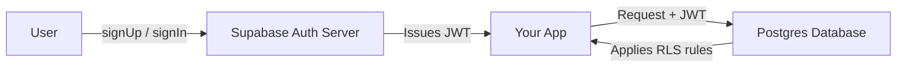

# How Supabase Auth works

Supabase handle users identity so you don't have to build login, do session management, or token logic from scratch. In this page we will understand what happens underneath when a user signs in.

## The authentication flow

To verify its users and grant access to the resources, Supabase Auth follows a secure standard-

1. After user registers using signUp(). Supabase will create a new record in the auth.users table and sends a confirmation email if email confirmation is enabled.
2. The user will then sign in using signIn(). You will send their credentials to the supabase Auth server.
3. The server verifies the credentials and issues a unique JSON Web Token (JWT).
4. Your application will store this token and include it in the header of every subsequent request.
5. The database uses the token to identify the user and apply security rules to the data.



## Access tokens and refresh tokens

Supabase Auth uses two types of tokens to maintain secure sessions.

The access token works like a short-lived ticket, it gets you through the door but it expires after one hour. When this token expires, your app uses the refresh token to request a new access token automatically. Supabase handles this in the background, so your users stay signed in without interruption. You never need to write this rotation yourself.

The refresh token is a long-lived credential stored alongside the access token. Supabase also rotate it automatically every time a new access token is issued. If a refresh token is compromised, you can revoke it from Supabase Dashboard under **Authentication→ Users**

## Session persistence

The Supabase client stores the user session in `localStorage` by default.

Which means users stay logged in even after they refresh the page or close and reopen the browser tab.

 > **Security notice:** `localStorage` is accessible to any JavaScript running on the page. If your application is vulnerable to Cross-Site Scripting(XSS) attacks, a malicious script could read the token and impersonate the user. In order for applications to handle sensitive or financial data, use `cookies` with the `httpOnly` flag as your storage engine instead. You can configure this initializing the Supabase client.

 You can override the default storage behavior when you initialize the client:

```javascript
const supabase = createClient(
  process.env.SUPABASE_URL,
  process.env.SUPABASE_ANON_KEY,
  {
    auth: {
      storage: window.sessionStorage, // session clears when tab closes
      persistSession: true,
    },
  }
)
```

## What Supabase Auth does not handle

Supabase Auth focuses on identity and authentication, leaving specific application logic to you.
Supabase Auth requires additional following features setup on your part because it focuses on identity verification only. This includes:

* **Granular roles and permissions**: Supabase Auth only tells your database who the user is, no what they are allowed to do. You need to define access rules using Postgres Row Level Security(RLS) policies in your project dashboard under Database → Policies.
* **Multi-factor authentication (MFA) enforcement**: While Supabase supports MFA, you must write the logic that requires it for specific actions or user roles. MFA is not enforced automatically.
* **Application-specific profile data**: You have to store additional data such as display names, avatars, or subscription status in a separate `profiles` table in your public schema. Supabase will only stores core identity field like `id`, `email`, and `created_at` in the `auth.users` table.

## Related resources

* [Get started with Supabase Auth](../getting-started.md) — Set up your project and make your first signUp() call.
* [View the signUp() API reference](../api-reference/sign-up.md) — See all parameters, return values, and error codes.
* [Supabase Row Level Security guide](https://supabase.com/docs/guides/auth/row-level-security) — Learn how to control what authenticated users can access
